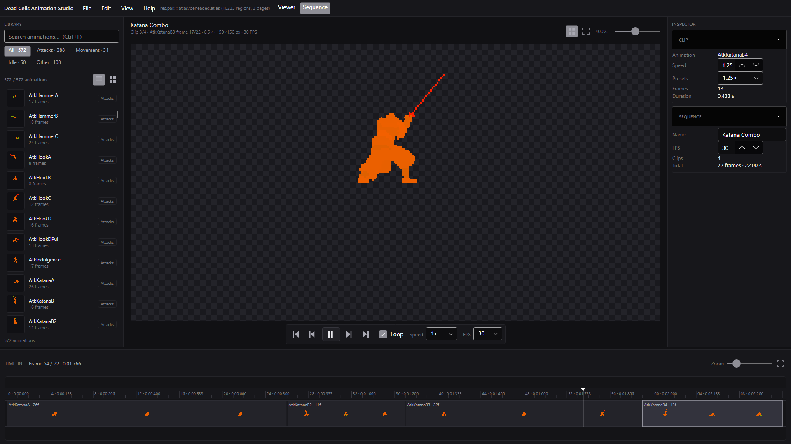

# Dead Cells Animation Studio

A standalone Windows desktop application for viewing, studying and inspecting
genuine **Dead Cells** hero animations outside the game.


AS-M1 (this milestone) delivers a launchable app with a real native animation
pipeline: it reads the game's own `res.pak` directly (no extraction step, no
bundled game art), decodes the binary **BATL** sprite atlas, and plays back
verified hero animations such as the Katana strike chain.


## Quick start

Prerequisites:

- Windows 10/11 (x64)
- [.NET 10 SDK](https://dotnet.microsoft.com/download) (build only)
- A legally obtained Dead Cells installation (Steam) — the app auto-detects
  `res.pak` and only ever opens it read-only

```powershell
# from the repository root
.\scripts\run.cmd
```

Or explicitly:

```powershell
dotnet run --project src/DcAnim.App -c Release
```

On startup the app locates `res.pak` (Steam registry + `libraryfolders.vdf` +
common paths, no hardcoded usernames). If nothing is found, use
**File > Open res.pak…** or **File > Open extracted atlas folder…**
(a folder containing `beheaded.atlas` plus its page PNGs, as produced by the
official `AtlasTool -Expand`).

Evidence capture (used for the screenshots above):

```powershell
dotnet run --project src/DcAnim.App -- --evidence <output-dir>
```

## What works (AS-M3 sequencing editor)

- Viewer mode (native inspection, unchanged) + Sequence mode toggle.
- Sequence projects (`.dcanim` JSON): ordered clips, per-clip speed
  (0.25–4x + presets), project FPS, deterministic integer-frame timing.
- Timeline editing: drag from library to append/insert, drag-reorder,
  select, duplicate, remove (menu + Delete), context speed menu.
- New / Open / Save / Save As with native dialogs, shortcuts, unsaved
  indicator + discard prompt; projects reopen without loss.
- Exports: transparent PNG sequence, animated GIF (documented timing +
  palette behavior), sprite sheet PNG + JSON metadata — all matching the
  editor preview frame-for-frame.
- 99 automated tests green, including round-trip, timing, scrub/loop, and
  export-decoding tests.



AS-M2 viewer foundations are unchanged; see `docs/AS-M2.2-REPORT.md`.

## Project layout

```text
src/DcAnim.Core/     PAK reader, BATL parser, frame composer, catalog +
                     categories, sequence model/timing/composer, PNG/GIF/
                     sheet exporters, playback engine, timeline math,
                     workspace settings, game locator (UI-free, tested)
src/DcAnim.App/      Avalonia workspace UI: viewer + sequence modes, asset
                     browser, viewport, transport, inspectors, viewer +
                     sequence timelines, export dialog
tests/DcAnim.Tests/  xUnit v3: format + workspace-logic + sequence/export +
                     native-asset tests
docs/                ARCHITECTURE.md, AS-M1/M2/M2.1/M2.2/M3 reports,
                     evidence/ (incl. katana-combo.dcanim tutorial project)
scripts/run.cmd      launcher
```

See [docs/ARCHITECTURE.md](docs/ARCHITECTURE.md) and
[docs/AS-M3-REPORT.md](docs/AS-M3-REPORT.md).

## Tests

```powershell
dotnet test tests/DcAnim.Tests
```

Native-asset tests auto-detect the local game install and skip cleanly
without one. `DCANIM_RESPAK` overrides the pak path;
`DCANIM_ATLASTOOL_REF` points at an `AtlasTool -Expand` directory to enable
the pixel-exact composer test.

## Distribution & modder notes

- **No proprietary game assets are bundled or copied into this repository.**
  Frames are decoded in memory at runtime from the user's own game files.
- Supported input: stock `res.pak` (PAK v1, read-only) or an extracted
  atlas folder. Nothing is written back to the game.
- Third-party notices: [docs/THIRD-PARTY-NOTICES.md](docs/THIRD-PARTY-NOTICES.md).
- License: MIT ([LICENSE](LICENSE)).
