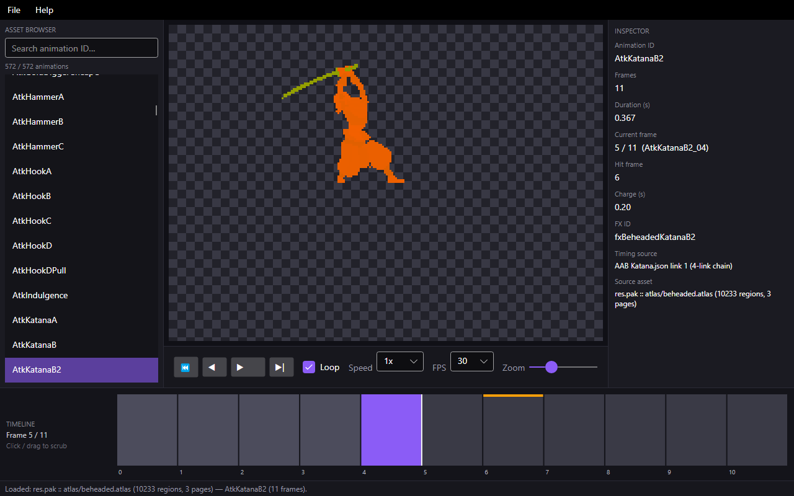
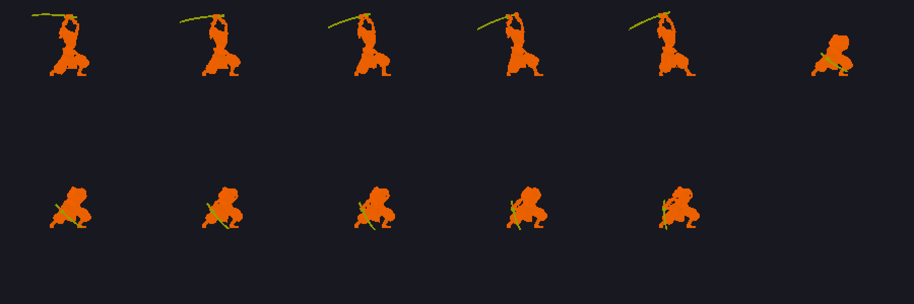
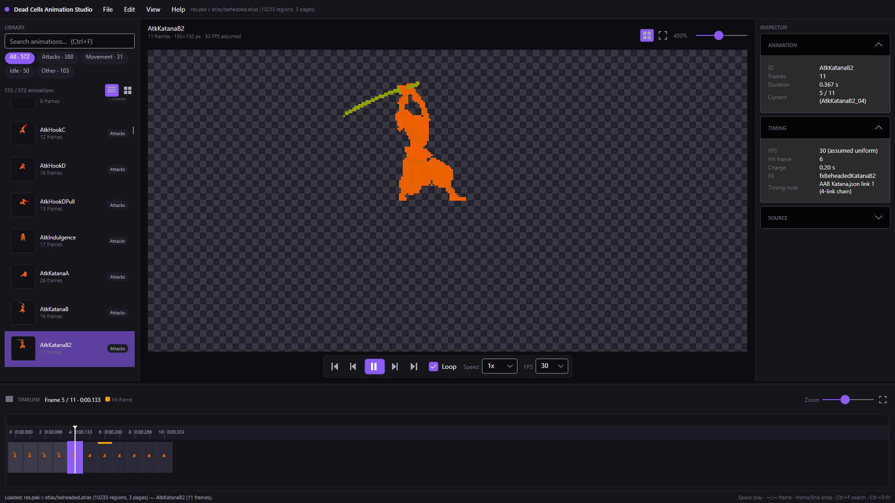

# Dead Cells Animation Studio

A standalone Windows desktop application for viewing, studying and inspecting
genuine **Dead Cells** hero animations outside the game.



AS-M1 (this milestone) delivers a launchable app with a real native animation
pipeline: it reads the game's own `res.pak` directly (no extraction step, no
bundled game art), decodes the binary **BATL** sprite atlas, and plays back
verified hero animations such as the Katana strike chain.




## Quick start

Prerequisites:

- Windows 10/11 (x64)
- [.NET 10 SDK](https://dotnet.microsoft.com/download) (build only)
- A legally obtained Dead Cells installation (Steam) — the app auto-detects
  `res.pak` and only ever opens it read-only

```powershell
# from the repository root
.\scripts\run.cmd
```

Or explicitly:

```powershell
dotnet run --project src/DcAnim.App -c Release
```

On startup the app locates `res.pak` (Steam registry + `libraryfolders.vdf` +
common paths, no hardcoded usernames). If nothing is found, use
**File > Open res.pak…** or **File > Open extracted atlas folder…**
(a folder containing `beheaded.atlas` plus its page PNGs, as produced by the
official `AtlasTool -Expand`).

Evidence capture (used for the screenshots above):

```powershell
dotnet run --project src/DcAnim.App -- --evidence <output-dir>
```

## What works (AS-M2 workspace)

- CapCut-inspired layout: top bar, resizable library / viewport / inspector,
  professional filmstrip timeline (ruler, playhead, hit marker, zoom, scrub)
- Native library: 572 hero animations with search, categories
  (Attacks 388 · Movement 31 · Idle 50 · Other 103), list/grid views, lazy
  thumbnails
- Genuine frame playback: play / pause / restart / first / prev / next /
  last, loop, timeline scrubbing, 0.25x–4x speed, 12–60 FPS, 1–8x zoom,
  fit-to-view, pan, checkerboard toggle
- Inspector: Animation / Timing / Source sections; CDB-derived timing overlay
  for the verified Katana links
- Keyboard shortcuts, tooltips, loading/empty/error states, persisted
  workspace layout



AS-M1 foundations (decoder, catalog, playback engine, pixel-exact tests)
are unchanged; see `docs/AS-M1-REPORT.md`.

## Project layout

```text
src/DcAnim.Core/     PAK reader, BATL parser, frame composer, catalog +
                     categories, playback engine, timeline math, workspace
                     settings, game locator (UI-free, tested)
src/DcAnim.App/      Avalonia workspace UI: theme + icons, asset browser,
                     viewport, transport, inspector, filmstrip timeline
tests/DcAnim.Tests/  xUnit v3: format + workspace-logic + native-asset tests
docs/                ARCHITECTURE.md, AS-M1-REPORT.md, AS-M2-REPORT.md,
                     evidence/
scripts/run.cmd      launcher
```

See [docs/ARCHITECTURE.md](docs/ARCHITECTURE.md) and
[docs/AS-M1-REPORT.md](docs/AS-M1-REPORT.md).

## Tests

```powershell
dotnet test tests/DcAnim.Tests
```

Native-asset tests auto-detect the local game install and skip cleanly
without one. `DCANIM_RESPAK` overrides the pak path;
`DCANIM_ATLASTOOL_REF` points at an `AtlasTool -Expand` directory to enable
the pixel-exact composer test.

## Distribution & modder notes

- **No proprietary game assets are bundled or copied into this repository.**
  Frames are decoded in memory at runtime from the user's own game files.
- Supported input: stock `res.pak` (PAK v1, read-only) or an extracted
  atlas folder. Nothing is written back to the game.
- Third-party notices: [docs/THIRD-PARTY-NOTICES.md](docs/THIRD-PARTY-NOTICES.md).
- License: MIT ([LICENSE](LICENSE)).
